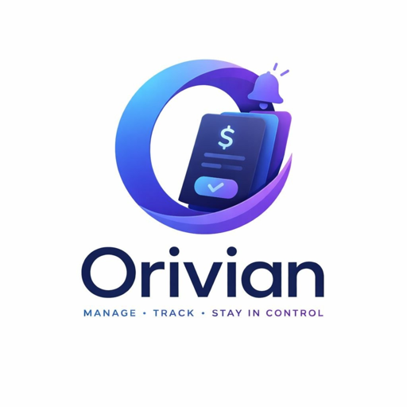
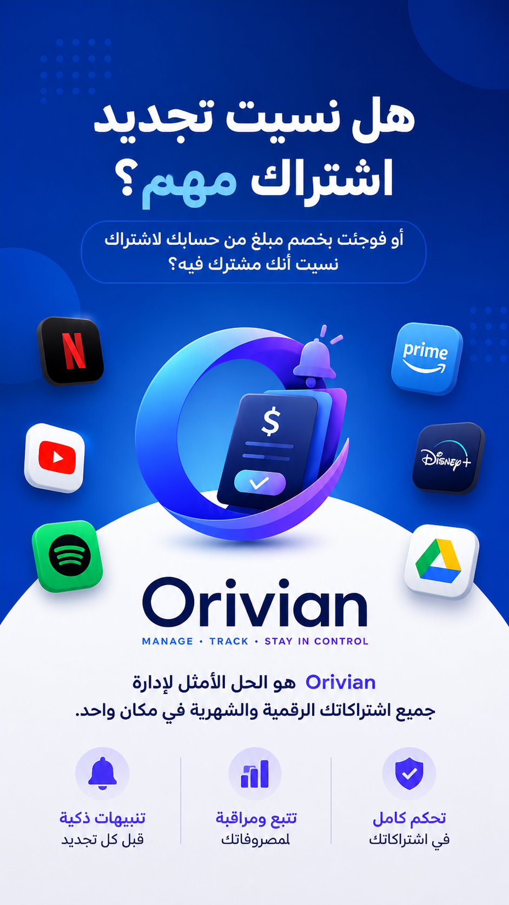
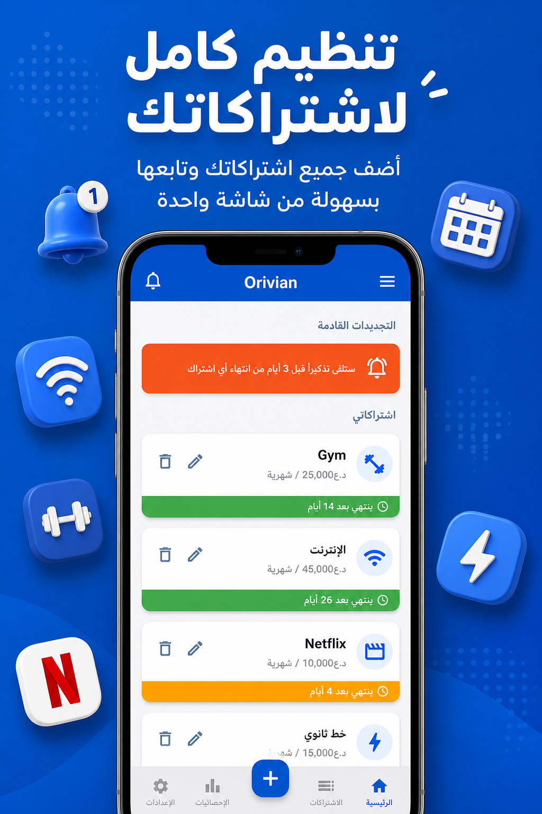
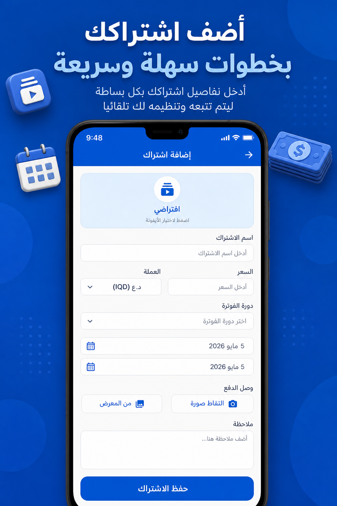
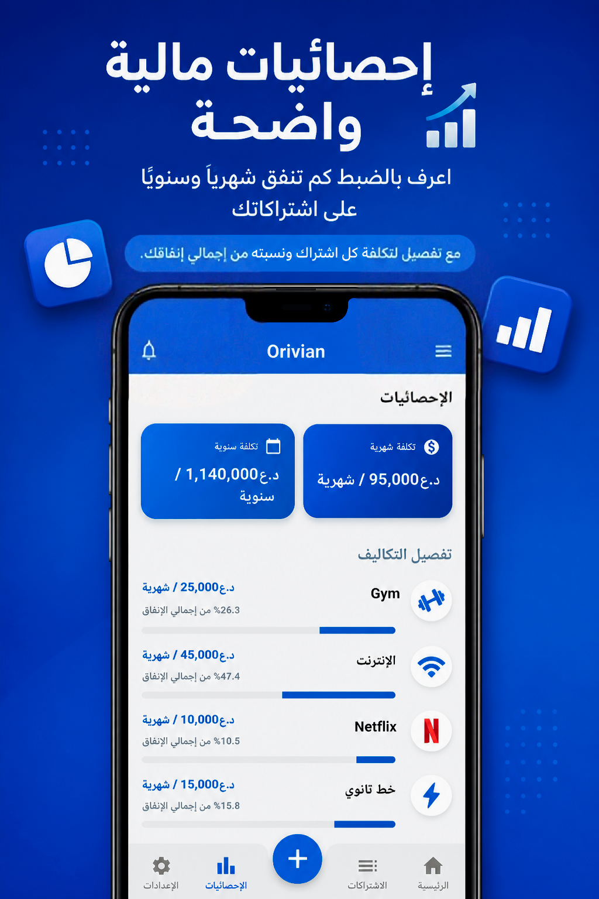
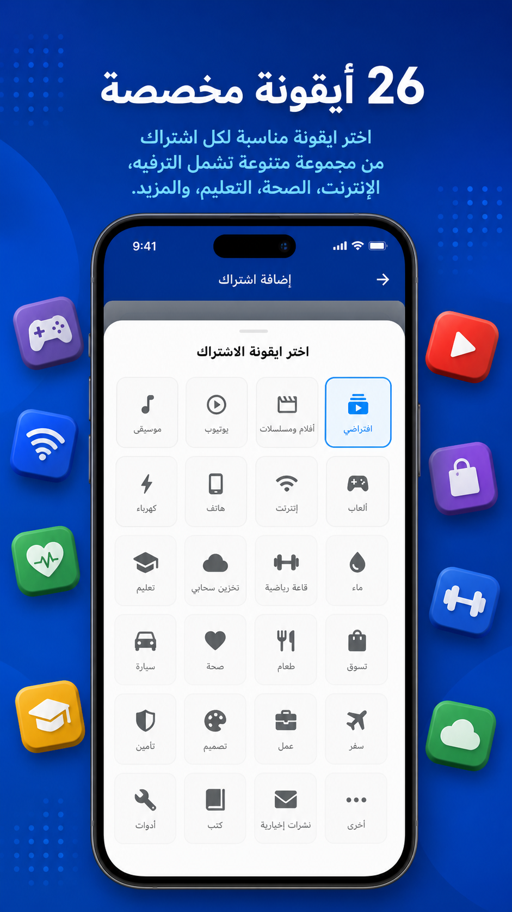
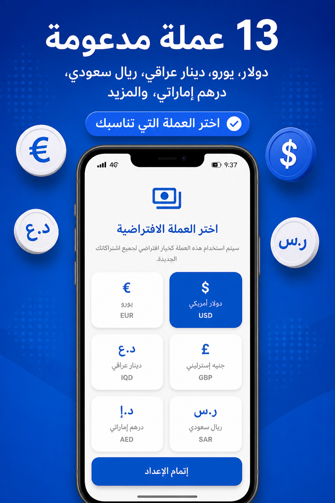
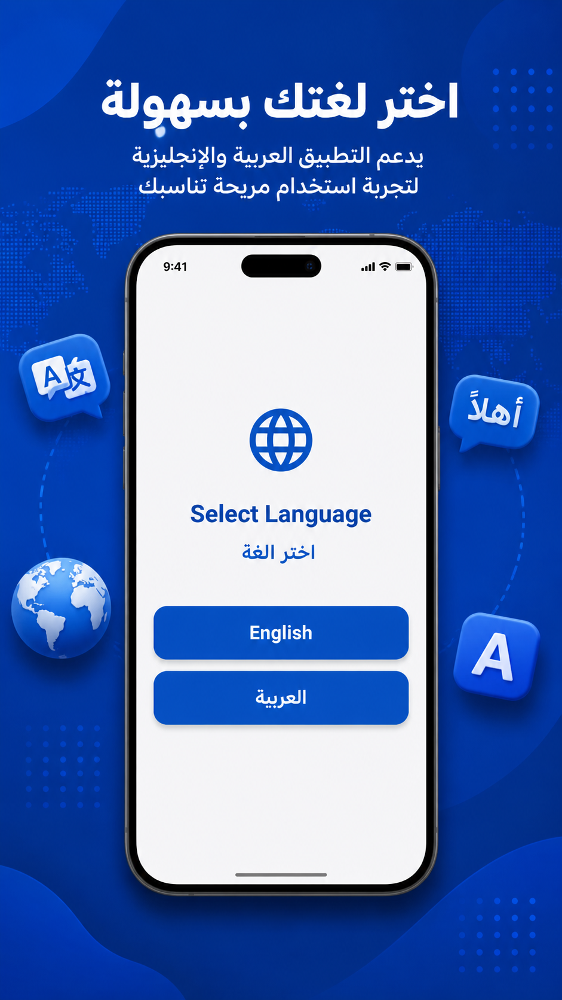
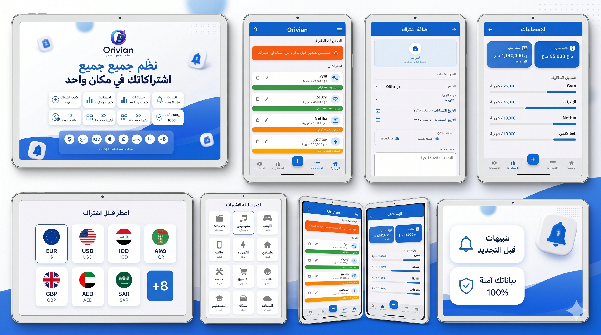
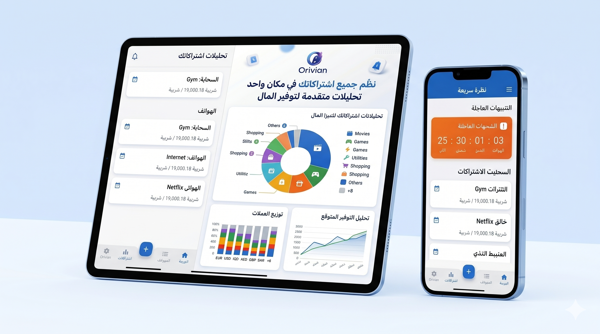

# تطبيق أوريفيان | Orivian

  

  <b>تطبيقك الذكي لإدارة وتتبع الاشتراكات الشهرية والسنوية وتنبيهات التجديد بدقة فائقة.</b> 
  <i>Smart subscription manager & renewal reminder tracker.</i>

  

  
  
  
  

---

## 📥 التحميل والتثبيت (Download & Install)

التطبيق متوفر الآن رسمياً للتحميل المباشر على متجر **Google Play** لجميع أجهزة أندرويد:

  
  

  <a href="https://play.google.com/store/apps/details?id=iq.orvex.orivian">
    <b>👉 اضغط هنا للانتقال إلى صفحة التطبيق على Google Play 👈</b>
  </a>

---

## 📱 لقطات من داخل التطبيق (App Screenshots)

  
  
  

  
  
  

  
  
  

---

## 📖 نبذة عن التطبيق (About Orivian)

تطبيق **Orivian** هو رفيقك المالي الذكي لإدارة ومتابعة كافة اشتراكاتك الدورية وخدماتك المدفوعة (مثل Netflix، Spotify، خدمات الاستضافة، فواتير الاتصالات، الجيم، وغيرها الكثير).

صُمم التطبيق بواجهة عربية وأجنبية عصرية وسريعة تمنحك رؤية واضحة لمصاريفك القادمة، وتضمن عدم نسيان أي اشتراك أو تجديده تلقائياً دون علمك بفضل نظام التنبيهات الدقيق.

---

## ✨ أبرز مميزات التطبيق (Key Features)

- **🔔 نظام تنبيهات دقيق ومرن:**
  - تخصيص وقت استلام التنبيه بالساعة والدقيقة بدقة متناهية.
  - خيارات تنبيه مرنة مسبقة: قبل 7 أيام، قبل 3 أيام، قبل يومين، قبل يوم واحد، أو في يوم التجديد نفسه.
  - دعم خاصية التنبيهات الدقيقة (**Exact Alarm**) لضمان إيصال الإشعار حتى لو كان الهاتف في وضع السكون.

- **📊 إحصائيات ورسوم بيانية تفاعلية:**
  - حساب إجمالي المصاريف الشهرية والسنوية بدقة.
  - تصنيف النفقات حسب الفئات (ترفيه، عمل، شخصي، أدوات، إلخ).

- **🗂️ إدارة وتنظيم شامل:**
  - دورات دفع متعددة تناسب كل أنواع الفواتير (أسبوعي، شهري، سنوي، أو مخصص).
  - إمكانية إرفاق صور الفواتير والإيصالات لكل اشتراك.
  - تخصيص ألوان وأيقونات مميزة لكل خدمة.

- **🌐 لغات وعملات متعددة:**
  - دعم كامل للغة **العربية** واللغة **الإنجليزية**.
  - دعم جميع العملات العالمية والمحلية (USD, IQD, SAR, AED, EUR...).

- **🔒 أمان وخصوصية تامة (Offline):**
  - التطبيق يعمل بالكامل على جهازك دون الحاجة لإنشاء حساب أو رفع بياناتك المالية على خوادم خارجية.
  - دعم كامل للوضع الليلي المريح للعين (Dark Mode) والوضع النهاري (Light Mode).

---

## 📩 الدعم والتواصل (Support & Contact)

لأي استفسارات أو مقترحات لتطوير التطبيق، يسعدنا تواصلكم عبر:
- **المطور:** ORFLYS
- **البريد الإلكتروني:** [admin@orflys.com](mailto:admin@orflys.com)
- **الموقع الإلكتروني:** [https://orflys.com](https://orflys.com)

---

  <b>جميع الحقوق محفوظة © 2026 ORFLYS</b> 
  <i>All rights reserved © 2026 ORFLYS</i>

